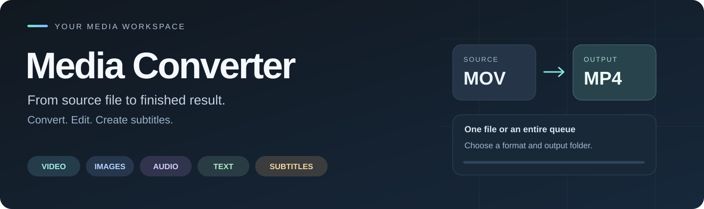
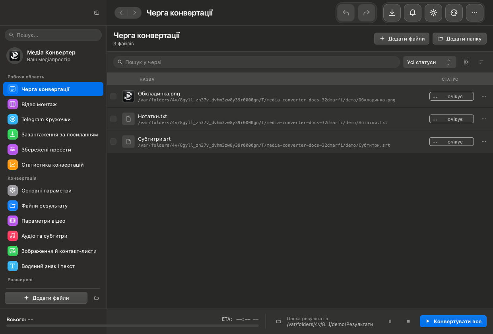
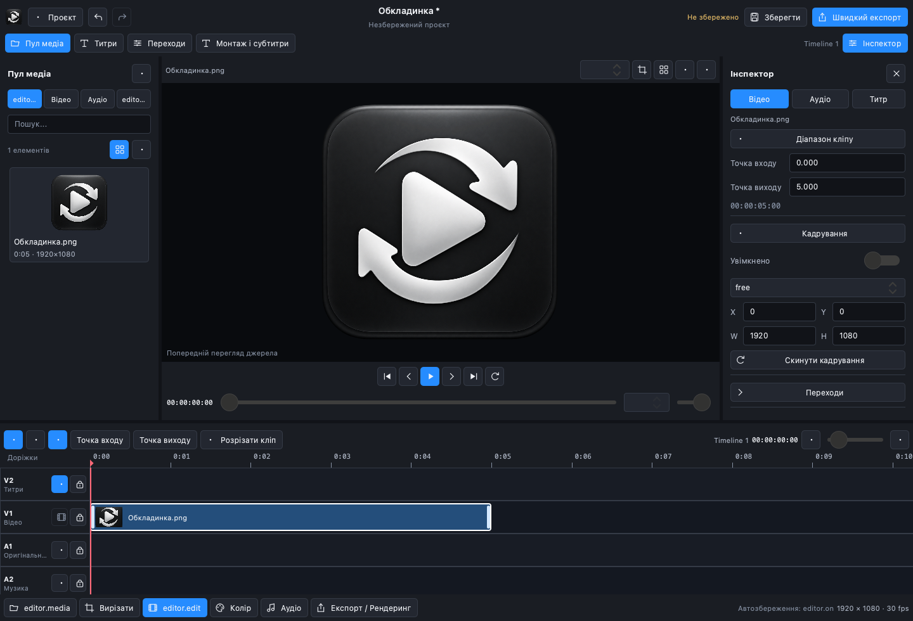
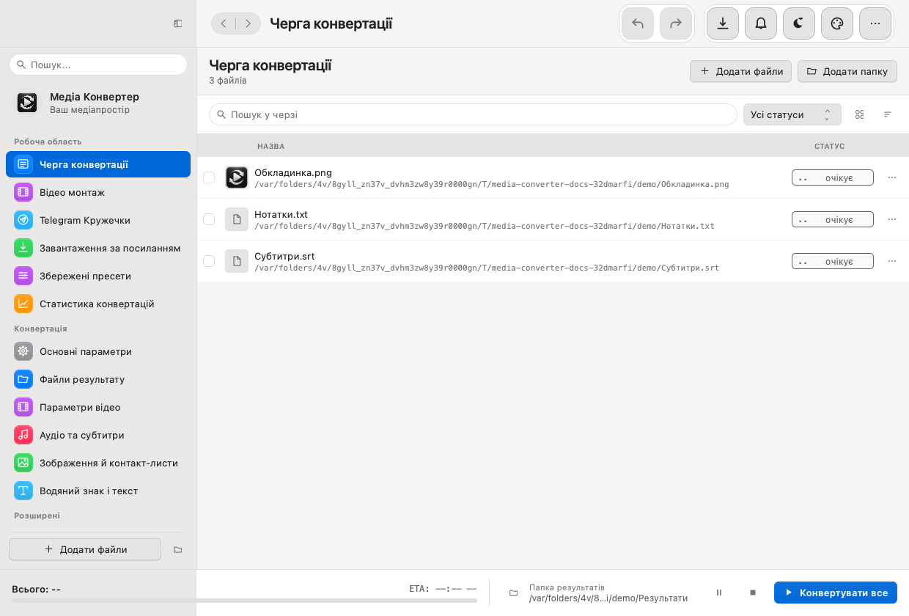

<p align="center">
  
</p>

<p align="center">
  <strong>Your files. The format you need. A workflow you can follow.</strong><br>
  A desktop workspace for video, images, audio, subtitles, and documents.
</p>



<p align="center">
  <strong>Python 3.12+</strong> · <strong>PySide6 / QML</strong> · <strong>FFmpeg</strong><br>
  Interface languages: Ukrainian · English · Polish · German
</p>

<p align="center">
  <a href="#installation">Installation</a> ·
  <a href="#features">Features</a> ·
  <a href="#screenshots">Screenshots</a> ·
  <a href="#command-line-interface">CLI</a> ·
  <a href="#development">Development</a> ·
  <a href="#license">License</a>
</p>

# Media Converter

Media Converter combines batch conversion with video editing, subtitle tools, document conversion, and media downloads. Add files to a queue, choose output settings, inspect the processing plan, and follow each task through completion. Use the graphical interface for interactive work or the CLI for repeatable jobs.

The project started as a MOV-to-MP4 batch converter, which explains the repository name `mov_to_mp4_batch_gui`. Its processing tools now cover more than video container conversion.

Python coordinates the interface and background services; FFmpeg performs media encoding and filtering. An optional Rust extension accelerates selected text-processing operations. A Rust toolchain, speech model, or cloud account is not required to launch the basic application.

> **Licensing:** personal, educational, and other non-commercial use is permitted under [LICENSE](LICENSE). Business use and paid projects require a separate purchased commercial license. This is source-available software.

## Features

### Batch conversion and queue management

- Add files through file selection, folder scanning, or drag and drop.
- Convert video, images, audio, subtitles, and text-based documents from one queue.
- Apply shared settings or overrides for individual items; prioritize and pin queue entries.
- Inspect media properties, previews, estimated output sizes, progress, speed, and remaining time.
- Pause, resume, cancel, or skip work; review failures and conversion history.
- Choose how to handle existing output names: stop, add an index, include a parent folder, or overwrite explicitly.
- Save reusable presets and import/export user presets as JSON. Built-in presets remain protected from accidental replacement.

### Video and audio

Choose output containers, codecs, quality settings, audio bitrate, resolution, trimming, and aspect-ratio options. Extract audio from video, adjust volume, and use supported normalization and filtering options.

The processing plan distinguishes compatible stream copying, video copying with audio conversion, and full video encoding. **Fast Copy / remux** avoids re-encoding compatible streams. Resizing, burned-in subtitles, and video filters require video encoding; a new container alone does not always require it.

**Target size** aims for a per-file byte limit using CPU H.264 and two-pass encoding. One MB means 1,000,000 bytes. The application budgets for audio and container overhead, checks the finished file before publication, and can retry at a lower bitrate. An oversized result is not published as a successful output. This mode supports MP4, MOV, MKV, and AVI, requires H.264 or Auto, and is incompatible with merging and ProRes. An unrealistically small limit can still fail.

### Video editing and previews

The montage workspace combines a media library, preview, properties panel, and timeline. Arrange and split clips, trim ranges, use transitions, add titles and subtitles, and mix voice with background music. Save an editable project separately from the exported video.

Preview strips, waveforms, snapshots, and proxy media help navigate source material. Proxy mappings survive application restarts. Additional workflows include portrait reframing, object blur, GIF/sticker creation, and Telegram-style video notes; some analysis tools require optional models or packages.

### Subtitles and speech recognition

Work with SRT, VTT, and ASS subtitles, edit text and timing, and burn subtitles into video where the selected FFmpeg build supports it. Styles may not survive conversion between subtitle formats.

Optional local speech recognition is available through a model manager:

| Engine | Device choices | Notes |
| --- | --- | --- |
| OpenAI Whisper | CPU, NVIDIA CUDA, Apple MPS | Device availability depends on the selected runtime and hardware. |
| Faster Whisper | CPU, NVIDIA CUDA | Uses CTranslate2; MPS is not supported by this engine. |

The application supports a managed isolated Python environment for speech tools, model downloads, runtime checks, and explicit device selection. Model downloads need network access and disk space; inference can run locally after installation. Large models need substantially more memory than small models.

### Images and documents

Convert image formats, resize and crop images, and apply watermarks or text overlays.

Document conversion focuses on extracting and transferring **text content**. Supported families include plain text, Markdown, HTML, PDF, Office, OpenDocument, and ebooks. It is not a full office layout engine: complex page layouts, formulas, macros, interactive elements, and formatting may be lost. Keep original files and inspect the result. Basic text-document conversion does not require FFmpeg.

### Downloads and automation

Download video or audio through `yt-dlp` from supported websites and supported direct media links. Available options include quality selection, playlists, subtitles, cookies files, and rate limits. Actual availability depends on the source site, authentication, and installed downloader version.

For repeatable workflows, use saved presets, watched folders, scheduling, batch rules, CLI settings files, and reports. Optional cloud uploads use an independently installed and configured `rclone`. Archive operations may require external 7-Zip or RAR tools. Some automation and advanced functions are gated by the application's Pro license state.

## Screenshots

### Conversion queue



Inspect input files, choose settings and an output folder, then process one item or the entire queue.

### Montage editor



Saving a project preserves editing decisions; exporting produces a media file.

<details>
<summary>Light appearance</summary>



Appearance settings include colors, text scale, and interface density. The interface adapts its controls and window presentation to the host platform.

</details>

Screenshots show the actual QML interface with demonstration data, not private media. Some screenshots use the Ukrainian interface; the application also provides English, Polish, and German. Native dialogs and window frames vary by operating system.

## Installation

### Requirements

| Component | Needed for |
| --- | --- |
| Python 3.12+ and `requirements.txt` | Running the application from source. |
| FFmpeg and FFprobe | Media conversion, inspection, filtering, and previews. Encoder/filter support depends on the build. |
| Whisper runtime and downloaded model | Optional speech recognition. |
| Rust and Maturin | Building the optional native extension from source. |
| `rclone`, 7-Zip, or RAR tools | The corresponding optional integrations. |

The interface includes platform adaptations for macOS and Windows. CI is configured for Linux, macOS, and Windows, including headless tests and portable package checks. Hardware acceleration, native dialogs, and driver behavior still depend on the actual machine. Packaged builds do not require a separate Python installation; model runtimes and external integrations may still need setup.

### Get the source

```bash
git clone https://github.com/Sergiy-Galenko/mov_to_mp4_batch_gui.git
cd mov_to_mp4_batch_gui
```

Alternatively, download and extract the repository ZIP from GitHub.

### macOS and Linux

Check that `python3 --version` reports Python 3.12 or newer, then run:

```bash
python3 -m venv .venv
source .venv/bin/activate
python -m pip install -r requirements.txt
python main.py
```

### Windows

Run these commands in PowerShell inside the project directory:

```powershell
py -3.12 -m venv .venv
.\.venv\Scripts\python.exe -m pip install -r requirements.txt
.\.venv\Scripts\python.exe main.py
```

Replace `-3.12` with the version selector for your installed Python if necessary. Calling the virtual environment's interpreter directly does not require PowerShell script activation.

### Configure FFmpeg and FFprobe

Obtain executables for your operating system from the [FFmpeg download page](https://ffmpeg.org/download.html). In application settings, select the full path to `ffmpeg` or `ffmpeg.exe`, and keep the matching `ffprobe` executable beside it.

The source application does **not** search the system PATH by default. You can select explicit paths in settings, set environment variables, or opt into PATH lookup:

```bash
# macOS / Linux: explicit paths
export MEDIA_CONVERTER_FFMPEG="/path/to/bin/ffmpeg"
export MEDIA_CONVERTER_FFPROBE="/path/to/bin/ffprobe"
python main.py

# Alternatively, allow lookup in PATH
export MEDIA_CONVERTER_ALLOW_PATH_BINARIES=1
```

```powershell
# Windows PowerShell: explicit paths
$env:MEDIA_CONVERTER_FFMPEG = 'C:\Tools\ffmpeg\bin\ffmpeg.exe'
$env:MEDIA_CONVERTER_FFPROBE = 'C:\Tools\ffmpeg\bin\ffprobe.exe'
.\.venv\Scripts\python.exe main.py
```

Verify the chosen executables with `-version`. For burned-in subtitles, the FFmpeg build must include the `subtitles` filter and libass support. The macOS CI configuration uses `ffmpeg-full` for this purpose.

### Optional speech runtime

The model manager can set up the managed runtime and download a model. To install OpenAI Whisper directly into an activated source environment instead:

```bash
python -m pip install -r requirements-whisper.txt
```

For Faster Whisper, install `faster-whisper` in the runtime you intend to use, then select that engine in the model manager. Verify the runtime and device before starting a long transcription. Installing the base requirements alone does not install speech engines or model weights.

## First conversion

1. Choose a writable output folder.
2. Add one or more source files, such as MOV videos.
3. Select MP4 as the output video format and choose a profile such as `Balanced`.
4. Check trimming, resolution, audio, and collision settings. Use Fast Copy only when the streams are compatible and video filtering is unnecessary.
5. Start the selected item or the queue and follow its progress.
6. Open the output file and inspect it. If a task fails, review its error and the application log.

## Formats and compatibility

These are representative formats, not a promise that every codec, document structure, or filter is supported by every installation.

| Category | Examples | Important limits |
| --- | --- | --- |
| Video | MP4, MOV, MKV, WEBM, AVI, GIF | Container/codec compatibility and installed FFmpeg encoders matter. ProRes requires MOV or MKV. |
| Images | JPG, PNG, WEBP, BMP, TIFF | Transparency and quality depend on the destination format. |
| Audio | MP3, M4A, AAC, WAV, FLAC, OPUS | Repeated lossy conversion can reduce quality. |
| Subtitles | SRT, ASS, VTT | Format conversion can discard styling. |
| Documents | TXT, MD, HTML, PDF, DOCX, XLSX, PPTX, ODT, ODS, ODP | Text-oriented conversion; legacy DOC/XLS/PPT paths are simplified. |
| Ebooks | EPUB, FB2, MOBI | Results depend on book structure and extractable content. |

## Hardware acceleration and resource management

Hardware encoders are probed through real encoding attempts rather than advertised solely because their names appear in FFmpeg. Supported paths include Apple VideoToolbox, NVIDIA NVENC/CUDA, Intel QSV, AMD AMF, and Linux VA-API when the device, drivers, codec, and build are compatible.

Compatible inputs can use hardware decoding and supported GPU scaling on CUDA, QSV, and VA-API paths. Unsupported filters use CPU processing. An enabled CPU fallback can recover from hardware failures, but probing one frame cannot establish compatibility with every source profile.

The adaptive scheduler reserves estimated CPU threads, RAM, hardware encoding sessions, and disk slots before admitting work. It coordinates concurrent FFmpeg processes with their internal thread budgets. The concurrency setting is an upper bound, not a guarantee that all slots will run simultaneously.

Successful measured workloads refine memory and initial timing estimates after enough comparable samples. Reservations and estimates are not hard operating-system quotas. GPU load is shown as unknown when no telemetry provider is available; missing telemetry is not treated as zero utilization. Disk slots are conservative limits rather than per-drive throughput measurements.

## Data, recovery, and privacy

| Platform | Default application data folder |
| --- | --- |
| macOS | `~/Library/Application Support/MediaConverter` |
| Windows | `%USERPROFILE%\AppData\Local\MediaConverter` |
| Linux | `~/.local/share/MediaConverter` |
| Portable package | `data` beside the executable when `portable.ini` is present. |

Set `MEDIA_CONVERTER_PORTABLE_DIR` to a writable root to isolate application data in its `data` subfolder. Back up settings, presets, queue state, and history together when moving an installation.

Queue items have persistent identities, and a SQLite journal records task transitions and output publication. Recovery checks source/output filesystem identities and output size. It does not perform a full content hash or decode of every recovered file, and interrupted multi-output or post-processing jobs may need attention.

A shared disk cache stores previews, waveforms, thumbnails, proxies, and probe metadata. Keys account for source identity, processing parameters, and tool identity. Its default artifact quota is 2 GiB with expiration after 30 days of inactivity. Active readers are protected from eviction, so the quota can be temporarily exceeded. Cache clearing in the system details dialog removes managed cache entries; previews may then need regeneration.

Diagnostic export writes a local support report with versions, hardware capabilities, cache totals, sanitized plan summaries, and categorized failures. It excludes source paths, filenames, raw commands, raw logs, hostnames, and secrets, and is not automatically uploaded. Downloads, model installation, updates, and enabled cloud features make their own network requests.

## Command-line interface

Run CLI commands from the prepared Python environment. Media jobs also need configured FFmpeg and FFprobe. Add `--language en` for English CLI messages.

```bash
# Convert one file
python main.py --cli -i input.mov -o ./converted --profile Balanced --language en

# Convert several files and add an index on output name collisions
python main.py --cli -i first.mov second.mov -o ./converted --collision-policy index

# Aim for an 8 MB video, using explicit tool paths
python main.py --cli -i input.mov -o ./converted --target-size-mb 8 \
  --ffmpeg /path/to/ffmpeg --ffprobe /path/to/ffprobe

# Reuse a saved preset or GUI-compatible settings JSON
python main.py --cli -i input.mov -o ./converted --preset "My preset"
python main.py --cli -i input.mov -o ./converted --settings-json settings.json

# Download audio without a conversion-queue run
python main.py --cli --download-url "https://example.com/video" \
  --download-mode audio --download-audio-format mp3 --download-only -o ./downloads

# Show all arguments
python main.py --cli --help
```

The URL above is a placeholder: replace it with a supported media URL. In PowerShell, put multiline examples on one line or use PowerShell's continuation syntax. Additional arguments control playlists, downloaded subtitles, cookies, rate limits, and CPU/GPU admission thresholds.

## Development

### Project structure

| Directory or entry point | Responsibility |
| --- | --- |
| `main.py`, `cli.py` | GUI startup, self-test entry point, and command-line workflows. |
| `app/` | Models, settings, localization, paths, constants, and profiles. |
| `services/` | Conversion plans, FFmpeg commands, scheduling, monitoring, cache, task recovery, editing, downloads, and integrations. |
| `ui/backend_components/` | Python backend components exposed to QML through the Qt facade. |
| `ui/qml/` | Screens, reusable controls, timeline, themes, and application window. |
| `utils/` | Shared process, persistence, locking, and utility code. |
| `native/` | Optional Rust/PyO3 text-processing extension with Python fallbacks. |
| `tests/` | Unit, QML, service, and actual FFmpeg integration tests. |
| `scripts/`, `build/` | Packaging, profiling, benchmarks, smoke verification, and screenshot tools. |
| `assets/`, `docs/images/` | Application artwork and README screenshots. |

### Checks

Install development dependencies in the same environment:

```bash
python -m pip install -r requirements.txt -r requirements-dev.txt
python -m ruff check app services ui utils tests cli.py main.py
python -m compileall -q app services ui utils tests
python -m pytest -q --tb=short
```

Tests isolate application data in a temporary portable root. On headless systems, set `QT_QPA_PLATFORM=offscreen` and `QT_QUICK_CONTROLS_STYLE=Basic`. Configure `MEDIA_CONVERTER_TEST_FFMPEG` for real encoder tests. Set `MEDIA_CONVERTER_REQUIRE_FFMPEG_TESTS=1` to require those integrations; CI enables this and must provide subtitle-capable FFmpeg. Some optional or platform-specific checks can still be skipped.

When changing the Qt backend, preserve property notifications and signal contracts. For QML startup failures, inspect the first unresolved component or property in the error chain. Localization changes should keep all four language dictionaries consistent.

### Optional Rust extension

With a Rust toolchain installed, build the extension in the activated environment:

```bash
python -m pip install 'maturin>=1.9,<2'
maturin develop --release --manifest-path native/Cargo.toml
```

The extension accelerates selected RTF processing and PDF literal decoding. Python fallbacks remain available if it cannot be imported. Set `MEDIA_CONVERTER_DISABLE_NATIVE=1` to use those fallbacks explicitly. It does not replace FFmpeg or accelerate encoding by itself.

### Portable packaging and smoke checks

Build on the operating system you intend to target, with matching FFmpeg and FFprobe binaries in one directory:

```bash
python scripts/build_pyinstaller.py --portable --ffmpeg-dir /path/to/ffmpeg/bin
python scripts/verify_package.py dist/MediaConverter/MediaConverter --report package-smoke.json
```

On Windows, use `dist\MediaConverter\MediaConverter.exe` for verification. A portable build includes `portable.ini` and the media tools. Package verification clears external tool overrides, loads the real QML, imports generated media, checks probing and conversion, and exercises pause/resume and cancellation cleanup in an isolated data directory.

CI separates required package uploads from diagnostic reports, including JUnit test results. Headless verification does not replace native desktop checks, real GPU testing, distribution signing, or macOS notarization.

### Profiling and benchmarks

```bash
python scripts/profile_pipeline.py --ffmpeg /path/to/ffmpeg --repeats 5
python scripts/performance_suite.py --ffmpeg /path/to/ffmpeg --report performance.json --repeats 3
python scripts/performance_suite.py --ffmpeg /path/to/ffmpeg --write-baseline baseline.json
python scripts/performance_suite.py --ffmpeg /path/to/ffmpeg --baseline baseline.json --max-regression 1.5
```

The performance suite covers a synthetic 4K encode, process peak memory, large queue imports, progress updates, previews, waveforms, and QML startup. Optional speech benchmarks accept `--speech-audio` and `--speech-model`; they require an installed runtime and downloaded model and do not download models automatically.

Baseline comparison requires a matching machine, tool identity, and workload schema. Pull-request CI runs the base revision on the same runner when a comparable suite exists. Missing or incompatible baselines are reported explicitly; timings vary with hardware contention.

Use `scripts/capture_readme.py` to refresh screenshots with demonstration files and inspect them before publication. The documentation banner is SVG artwork. Screenshot fixtures use generated text/subtitles and the project's logo, without private media. The current logo is `assets/app-logo-v2.png`, originally generated with an image-generation tool; artwork and screenshots are covered by the repository license.

## Troubleshooting

| Problem | What to check |
| --- | --- |
| `No module named PySide6` | Install `requirements.txt` with the interpreter used to launch the application. |
| FFmpeg works in a terminal but is not found in the app | Select its full path, set the explicit environment variables, or enable PATH lookup. |
| Subtitles fail to render | Check that the selected FFmpeg includes the `subtitles` filter/libass and that the subtitle file is readable. |
| Hardware encoding fails | Verify driver and encoder support; try CPU encoding or enable the supported fallback. |
| A conversion will not start | Check the output folder, permissions, free space, preflight messages, and resource thresholds. |
| Whisper fails or runs on an unexpected device | Verify the selected runtime, installed model, engine/device pairing, and available memory in the model manager. |
| `QQmlApplicationEngine failed to load component` | Inspect the first relevant error in the QML chain and run the QML loading tests. |
| Portable package verification fails | Confirm that both bundled media executables run and that the package has a writable data location. |

Report reproducible issues through [GitHub Issues](https://github.com/Sergiy-Galenko/mov_to_mp4_batch_gui/issues). Include the OS, application/Python version, reproduction steps, and relevant error text. Review attached reports and logs before sharing; do not include license keys, cookies, or private media.

## License

The project uses a **Source-Available Non-Commercial License**. The source is available for inspection and permitted non-commercial use under [LICENSE](LICENSE).

| Use | Terms |
| --- | --- |
| Personal files, education, testing, and non-commercial research | Permitted subject to LICENSE. |
| Non-commercial modification and redistribution | Retain license/copyright notices and identify modifications as required by LICENSE. |
| Business workflows, paid client work, sales, or commercial product integration | Requires a separate purchased commercial license. |
| Third-party libraries, tools, and codecs | Their own licenses also apply. |

This explanation does not replace the license text. An in-app Pro trial does not independently grant commercial rights. Contact the [repository maintainer](https://github.com/Sergiy-Galenko) about commercial licensing.
